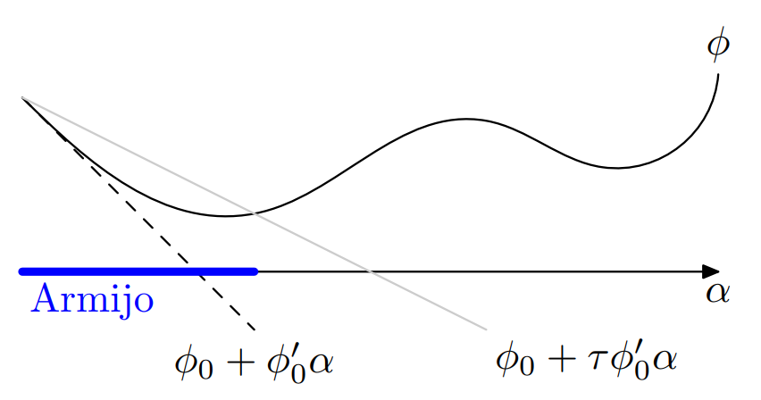
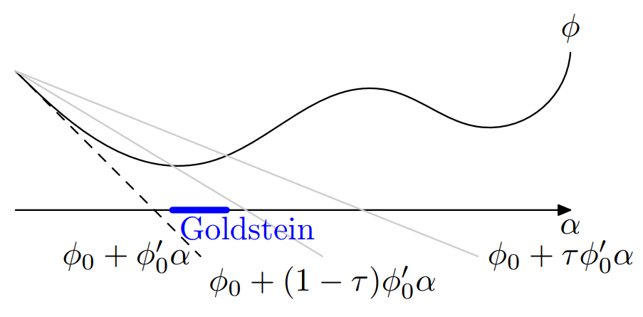

# Análisis Numérico II / Álgebra Lineal Numérica
## Clase 19: Minimización No Lineal

---

# Cuadrados Mínimos No Lineales

Cuando $F: \mathbb{R}^n \to \mathbb{R}^m$ con $m \neq n$ o la Jacobiana es singular, se reformula el problema como la minimización de la norma del residuo:
$$\min_{x \in \mathbb{R}^n} f(x) = \frac{1}{2} \|F(x)\|_2^2$$

- $f(x)$ es diferenciable si $F$ es diferenciable.
$$
\begin{aligned}
f(x + h) &= \frac{1}{2} \|F(x + h)\|_2^2 = \frac{1}{2} \|F(x) + F'(x)h + o(\|h\|)\|_2^2 \\
&= \frac{1}{2} \left( \|F(x)\|_2^2 + 2F(x)^{\text{T}} F'(x)h + \|F'(x)h\|_2^2 + o(\|h\|) \right) \\
&= f(x) + \left(F'(x)^{\text{T}} F(x)\right)^{\text{T}} h + o(\|h\|).
\end{aligned}
$$

---

# Cuadrados Mínimos No Lineales

- El gradiente de $f(x)$ satisface $\nabla f(x) = F'(x)^T F(x)$.
- Suponga que $F$ es diferenciable. Se cumple que $F(x^*) = 0$ si y solo si $\nabla f(x^*) = 0$ y existe $d$ tal que $F(x^*) + F'(x^*) d = 0$.
- La función objetivo $f(x)$ puede presentar minimizadores locales donde $F(x) \neq 0$ ($\nabla f(x^*) = 0$ con $F(x^*) \neq 0$).
- **Proposición:** Sea $F: \mathbb{R}^n \to \mathbb{R}^m$ diferenciable y $f(x) = \frac{1}{2} \|F(x)\|_2^2$. Entonces $F(x^*) = 0$ si y solo si $\nabla f(x^*) = 0$ y existe $d$ tal que $\nabla F(x^*) d = -F(x^*)$.

---

# Marco General de la Minimización No Lineal

Dado un problema con dominio $\mathcal{D} \subset \mathbb{R}^n$, se busca hallar un vector $x^*$ que resuelva:
$$\min_{x \in \mathcal{D}} f(x) \quad$$

**Definiciones:**
- **Función Objetivo:** La función $f: \mathbb{R}^n \to \mathbb{R}$ a minimizar.
- **Conjunto Factible:** El subconjunto de $\mathbb{R}^n$ donde se busca la solución.
- **Valor Mínimo:** $v_* = \inf_{x \in \mathcal{D}} f(x) \in [-\infty, +\infty]$.
- **Minimizador Global:** $x^* \in \mathcal{D}$ tal que $f(x^*) \le f(x)$ para todo $x \in \mathcal{D}$.
- **Minimizador Local:** $x^* \in \mathcal{D}$ si existe $\epsilon > 0$ tal que $f(x^*) \le f(x)$ para todo $x \in \mathcal{B}(x^*, \epsilon) \cap \mathcal{D}$.

---

# Condiciones de Optimalidad

### Teorema (Condiciones Necesarias de Optimalidad):
Sea $x^*$ un minimizador local de $f$ en $\mathbb{R}^n$:
1. **Primer orden:** Si $f$ es diferenciable en $x^*$, entonces $\nabla f(x^*) = 0$.
2. **Segundo orden:** Si $f$ es dos veces diferenciable en $x^*$, entonces la matriz Hessiana $\nabla^2 f(x^*)$ es semidefinida positiva.

---

# Condiciones de Optimalidad

### Definición (Punto Estacionario)
Un punto $x^* \in \mathbb{R}^n$ es un punto estacionario si satisface $\nabla f(x^*) = 0$.

### Teorema (Condición Suficiente de Optimalidad)
Si $f$ es dos veces diferenciable en $x^*$, $\nabla f(x^*) = 0$ y $\nabla^2 f(x^*)$ es **definida positiva**, entonces $x^*$ es un minimizador local de $f$. Existen $\epsilon > 0$ y $\gamma > 0$ tales que:
$$f(x) \ge f(x^*) + \frac{\gamma}{2} \|x - x^*\|^2, \quad \forall x \in \mathcal{B}(x^*, \epsilon) \quad$$

---

# Pasando a la Práctica

- En la práctica no es posible despejar $x^*$ de la ecuación no lineal $\nabla f(x) = 0$, pero puede ser nuestra condición para parar un algoritmo (con tolerancia)
- Si $\|\nabla f(x^k)\| \neq 0$, $x^k$ no es estacionario. Generamos la siguiente aproximación $x^{k+1}$, desacoplamos el movimiento en dos decisiones independientes:
   - Hacia dónde moverse? (dirección $d^k$)
   - Cuánto avanzar? (paso $\alpha_k$)

---
# Proceso de Búsqueda Lineal

- Usamos Taylor
$$f(x_k + \alpha d_k) \approx f(x_k) + \alpha \nabla f(x_k)^T d_k$$
- De esta expansión surge de forma natural la condición de dirección de descenso:
$$f(x_k + \alpha d_k) < f(x_k) \implies \nabla f(x_k)^T d_k < 0$$
- Definimos la función auxiliar de una sola variable real $\alpha$: 
$$\phi(\alpha) = f(x_k + \alpha d_k), \quad \text{con } \phi(0) = f(x_k) \text{ y } \phi'(0) = \nabla f(x_k)^T d_k < 0$$

---

# Esquema General de Búsqueda Lineal

Los algoritmos de **búsqueda lineal** generan una sucesión $x_{k+1} = x_k + \alpha_k d_k$:

1. Dar $x^0 \in \mathbb{R}^n$ y $k = 0$.
2. Si $\|\nabla f(x^k)\| = 0$, detener el proceso (punto estacionario alcanzado).
3. Obtener una **dirección de descenso** $d^k \in \mathbb{R}^n$ tal que $\nabla f(x^k)^T d^k < 0$.
4. Obtener un **tamaño de paso** $\alpha_k > 0$ tal que $f(x^k + \alpha_k d^k) < f(x^k)$.
5. Definir $x^{k+1} = x^k + \alpha_k d^k$, hacer $k \leftarrow k + 1$ y **regresar al Paso 1**.

---

# Cómo seleccionar el paso?

- Buscar el paso exacto $\alpha_k = \arg\min_{\alpha \ge 0} \phi(\alpha)$ es computacionalmente impracticable. 
- Para resolver este inconveniente, se introducen las reglas de aceptación inexacta de paso, las cuales evitan dos errores graves en el cómputo:
  - **Pasos demasiado largos**: Un paso muy largo puede sobrepasar el mínimo local e incrementar el valor de $f$.
  - **Pasos infinitesimales**: Un paso muy corto puede cumplir $f(x_{k+1}) < f(x_k)$, pero reduce el avance del algoritmo.

---

# Algoritmo: Regla de Armijo

Garantiza un **descenso suficiente** reduciendo el paso inicial $\alpha = 1$ mediante un factor $\beta \in (0, 1)$ hasta satisfacer $\phi(\alpha) \le \phi_0 + \tau \alpha \phi'_0$, con $\tau \in (0, 1)$.

**Entradas:** $f: \mathbb{R}^n \to \mathbb{R}$, $x, d \in \mathbb{R}^n$, $\phi_0 = f(x)$, $\phi'_0 = \nabla f(x)^T d$, $m \in \mathbb{N}$, $\tau, \beta \in (0, 1)$.
**Salida:** $x^+ = x + \alpha d$.
1. Definir $\alpha = 1$.
2. Para $k = 1, \dots, m$, definir $x^+ = x + \alpha d$, $\phi = f(x^+)$.
   Si $\phi \le \phi_0 + \tau \alpha \phi'_0$, ir al paso 3. Sino, hacer $\alpha \leftarrow \beta \alpha$.
3. Retornar $x^+$.

*En la práctica se utilizan típicamente $\beta = 0.5$ y $\tau = 10^{-4}$.*

---

# Algoritmo: Regla de Goldstein

Evita que el paso $\alpha$ sea demasiado pequeño imponiendo una **cota inferior y superior** sobre el incremento funcional mediante el parámetro $\tau \in (0, 1/2)$.

**Entradas:** $f: \mathbb{R}^n \to \mathbb{R}$, $x, d \in \mathbb{R}^n$, $\phi_0, \phi'_0 \in \mathbb{R}$, $m \in \mathbb{N}$, $\tau \in (0, 1/2)$, $\beta \in (0, 1)$, $\rho > 1$.
**Salida:** $x^+ = x + \alpha d$.
1. Definir $\alpha = 1$, $\alpha_l = 0$ y $\alpha_u = +\infty$.
2. Para $k = 1, \dots, m$, definir $x^+ = x + \alpha d$, $\phi = f(x^+)$.
   - Si $\phi \le \phi_0 + \alpha \tau \phi'_0$, ir al paso 2 si $\phi \ge \phi_0 + \alpha (1 - \tau) \phi'_0$ o hacer $\alpha_l = \alpha$ caso contrario. Sino, hacer $\alpha_u = \alpha$.
   - Definir $\alpha = (1 - \beta)\alpha_l + \beta \alpha_u$ si $\alpha_u < +\infty$, o $\rho \alpha_l$ si $\alpha_u = +\infty$.
3. Retornar $x^+.$

---

# Gráficos de Selección

    
    

---

# Estrategias Alternativas para la Selección del Paso

Además de las reglas de Armijo y Goldstein, existen otras maneras de determinar $\alpha_k$:

- **Paso Exacto:** Se toma $\alpha_k = \arg\min_{\alpha \ge 0} f(x^k + \alpha d^k)$. Se utiliza cuando la minimización unidimensional se deduce analíticamente mediante una fórmula cerrada (ej. métodos de proyección).
- **Paso Menguante:** Se predefine una sucesión $\{\alpha_k\}$ que satisface $\alpha_k \to 0^+$ y $\sum_{k=0}^\infty \alpha_k = +\infty$. Se aplica si la evaluación funcional de $f(x)$ es muy costosa.
- **Paso Constante:** Se fija $\alpha_k = \alpha > 0$ siempre. Sólo se aconseja en problemas con estructura particular y cotas espectrales conocidas.

---

# Algoritmo: Método de Cauchy para Minimización

Utiliza la dirección de **máximo descenso** $d^k = -\nabla f(x^k)$, que resulta de minimizar $\nabla f(x^k)^T d$ sobre la bola $\|\cdot\|_2 \le 1$.

**Entradas:** $f: \mathbb{R}^n \to \mathbb{R}$, $x \in \mathbb{R}^n$, $\epsilon > 0$ y $m \in \mathbb{N}$.
**Salida:** $x^+$ aproximación de $x^*$.
1. Obtener $\phi = f(x)$, $r = \nabla f(x)$ y definir $\sigma = \|r\|_2$.
2. Para $k = 1, \dots, m$, si $\sigma \le \epsilon$, ir al paso 3. Sino, definir:
   - $x$ aplicando el **Algoritmo (Armijo)** con $\phi_0 = \phi$ y $\phi'_0 = -\sigma^2$.
   - $\phi = f(x)$, $r = \nabla f(x)$, $\sigma = \|r\|_2$.
3. Retornar $x^+ = x$.

---

# Algoritmo: Método de Newton para Minimización

Resuelve el sistema de segundo orden $\nabla^2 f(x^k) d^k = -\nabla f(x^k)$ derivado de la condición de estacionariedad $\nabla f(x) = 0$.

**Entradas:** $f: \mathbb{R}^n \to \mathbb{R}$, $x \in \mathbb{R}^n$, $\epsilon > 0$ y $m \in \mathbb{N}$. **Salida:** $x^+$ aproximación de $x^*$.
1. Obtener $\phi = f(x)$, $r = \nabla f(x)$ y $H = \nabla^2 f(x)$.
2. Para $k = 1, \dots, m$, si $\|r\|_2 \le \epsilon$, ir al paso 3. Sino, definir:
   - $d$ tal que $r + H d = 0$ resolviendo el sistema SDP mediante Cholesky.
   - $x$ aplicando Armijo con $\phi_0 = \phi$ y $\phi'_0 = r^T d$.
   - $\phi = f(x)$, $r = \nabla f(x)$, $H = \nabla^2 f(x)$.
3. Retornar $x^+ = x$.

---

# Modificaciones del Método de Newton

Cuando $f$ no es estrictamente convexa, la Hessiana $\nabla^2 f(x^k)$ puede ser indefinida o singular. Se aplican modificaciones para garantizar la definición positiva:

- **Cholesky Modificado:** Reemplaza los pivotes $G_{ii} \le \epsilon_0$ por $\epsilon_1 > \epsilon_0 \ge 0$ antes de calcular la raíz cuadrada, asegurando $G^T G = \nabla^2 f(x^k) + E_k > 0$.
- **Dirección de Gauss-Newton:** Para problemas de cuadrados mínimos no lineales $f(x) = \frac{1}{2}\|F(x)\|_2^2$, se aproxima la Hessiana omitiendo las derivadas de segundo orden: $H_k = F'(x^k)^T F'(x^k) \ge 0$.
- **Método de Levenberg-Marquardt:** Regulariza la matriz de Gauss-Newton sumando un término diagonal $\gamma_k I$ con $\gamma_k > 0$: $H_k = F'(x^k)^T F'(x^k) + \gamma_k I > 0$.

---

# Algoritmo: Método BFGS para Minimización

Implementa la actualización secante de rango 2 para la inversa de la Hessiana $W_k \approx (\nabla^2 f(x^k))^{-1}$, permitiendo calcular $d = -W r$ con un producto matriz-vector.

**Entradas:** $f: \mathbb{R}^n \to \mathbb{R}$, $x \in \mathbb{R}^n$, $\epsilon > 0$ y $m \in \mathbb{N}$.

1. Obtener $\phi = f(x)$, $r = \nabla f(x)$, definir $W = I$ y $x^+ = x$.
2. Para $k = 1, \dots, m$, si $\|r\|_2 \le \epsilon$, ir al paso 2. Sino, definir:
   - $d = -W r$, $x^+$ aplicando Armijo con $\phi_0 = f(x)$ y $\phi'_0 = r^T d$.
   - $\phi = f(x^+)$, $r^+ = \nabla f(x^+)$, $y = r^+ - r$, $v = x^+ - x$, $w = W y$.
   - $\gamma = y^T v$, $\tau = y^T w$, $p = v/\gamma - w/\tau$.
   - $W = W + \frac{v v^T}{\gamma} - \frac{w w^T}{\tau} + \tau p p^T$, $x = x^+$, $r = r^+$.
3. Retornar $x^+$.

---

# Peligro de las Búsquedas Unidimensionales

Minimizar a lo largo de líneas rectas no equivale a encontrar un mínimo local en $\mathbb{R}^n$.

Dada $f(x_1, x_2) = (x_2 - p x_1^2)(x_2 - q x_1^2)$ con $0 < p < q$, el origen $(0,0)$ es un minimizador local a lo largo de **toda recta** que pasa por él, pero **no es un minimizador local en $\mathbb{R}^2$**.

---

# Teorema (Convergencia del Método de Búsqueda Lineal)

Sea $f$ continuamente diferenciable y $\{x^k\}$ generada por un método de búsqueda lineal con paso de Armijo y dirección que satisface:

$$
\nabla f(x^k)^T d^k \le -\gamma \|\nabla f(x^k)\|^q \quad \text{con } \gamma, q > 0.
$$

Todo punto límite $x^*$ de la sucesión $\{x^k\}$ es un **punto estacionario** ($\nabla f(x^*) = 0$).
